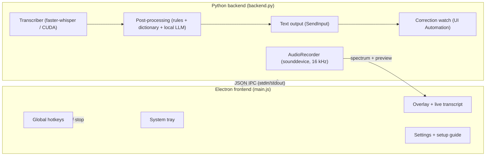

# Developing NoType

NoType is a hybrid app. A **Python backend** handles audio capture, [faster-whisper](https://github.com/SYSTRAN/faster-whisper) inference, text insertion and the Ollama lifecycle. An **Electron frontend** handles the tray, overlay, settings and global hotkeys. The two talk newline-delimited JSON over stdin/stdout.

| Layer | Tech |
|---|---|
| Speech recognition | faster-whisper (CTranslate2), CUDA 12 with cuBLAS/cuDNN, automatic CPU fallback |
| AI cleanup & command mode | Ollama (portable, managed by the app) with Qwen 3 / Qwen 3.5 / Gemma 4 |
| Audio | sounddevice at 16 kHz, live spectrum bands for the overlay |
| Text insertion | Win32 `SendInput` + clipboard, Unicode typing fallback |
| Correction learning | Windows UI Automation (reads the dictated field only, never password fields) |
| Frontend | Electron 33, plain HTML/CSS/JS, no framework |
| Packaging | PyInstaller (backend) + electron-builder (NSIS installer) |



## Build from source (Windows)

You need Windows 11 x64, **Python 3.12** (what the README has always asked for; other versions are not tested) and **Node.js 18 or newer**. An NVIDIA GPU is optional for running, but the backend build bundles cuBLAS either way.

```bat
:: Backend. The venv must be called "venv" and sit in the repository root:
:: `npm start` runs venv\Scripts\python.exe backend.py from there.
py -3.12 -m venv venv
venv\Scripts\activate
pip install -r requirements.txt

:: Frontend, dev mode (uses the venv above, no build needed)
cd electron
npm install
npm start
```

To build the installer:

```bat
:: from the repository root, venv active; writes dist\backend\
pip install -r requirements-build.txt
pyinstaller --noconfirm backend.spec

:: writes dist\NoType-Setup-<version>.exe, or dist\win-unpacked\ with build:dir
cd electron
npm run build
npm run build:dir
```

- `requirements-build.txt` adds PyInstaller and `nvidia-cublas-cu12`. `backend.spec` copies `cublas64_12.dll` and `cublasLt64_12.dll` from that package next to the CTranslate2 DLLs and stops with an error when they are missing, because without them the GPU path silently falls back to the CPU on most PCs.
- On a PC without a CUDA 12 toolkit on `PATH` the bundled DLLs are the only cuBLAS; if loading the model on the GPU fails anyway, the backend retries on the CPU (`init_transcriber` in `backend.py`) and reports `CPU (int8)` as the device.
- `backend.spec` also generates the comtypes wrappers for UI Automation at build time, so the build has to run on Windows.
- Release steps (version bump, portable ZIP, GitHub release) are in [RELEASING.md](../RELEASING.md).

## What you can test on Linux or macOS

Most of the app needs Windows: audio capture, hotkeys, text insertion, UI Automation, the Electron UI and the installer. The text logic does not. These modules import without Windows, faster-whisper, sounddevice or pyperclip and only need numpy:

`config.py`, `dictionary.py`, `spoken_punctuation.py`, `hallucinations.py`, `postprocess.py`, `agent_webhook.py`, `ollama_manager.py` (import only; its functions call Windows tools).

`config.py` creates its settings folder on import (`%APPDATA%\NoType` or `$XDG_CONFIG_HOME/NoType`). In tests and experiments, point `XDG_CONFIG_HOME` (and unset `APPDATA`) at a temporary folder **before** importing `config` or anything that imports it, so your real settings stay untouched.

```bash
python3 -m venv .venv
. .venv/bin/activate
pip install -r requirements-dev.txt      # if present, otherwise: pip install numpy pytest ruff

pytest                                   # the tests set their own config folder
ruff check .
python tools/gen_config_docs.py --check  # docs/configuration.md matches config.py
for f in electron/*.js tools/svg_to_png.js; do node --check "$f"; done
```

Ruff uses the project configuration in `pyproject.toml` if present. Without one, a recent ruff reports many style findings in the existing code; `ruff check --select E9,F .` then checks only syntax errors and pyflakes.

Changes in Windows-only code can't be verified this way. Say so in your pull request and describe how you tested on Windows, if you could.

## Configuration

Every key in `settings.json` is listed in [configuration.md](configuration.md). That page is generated from `DEFAULT_CONFIG` in `config.py`; after changing it, run `python tools/gen_config_docs.py` and commit both.

## Project structure

```
NoType/
├── backend.py             # IPC loop, recording, transcription orchestration
├── audio_recorder.py      # sounddevice capture, spectrum bands, rolling preview window
├── transcriber.py         # faster-whisper wrapper, language mix, batched long dictations, cuBLAS fallback
├── hallucinations.py      # known Whisper hallucinations ("Thanks for watching!", subtitle credits)
├── spoken_punctuation.py  # "question mark", "neue Zeile" … become characters (de, en, pl)
├── postprocess.py         # rule cleanup + local LLM polish and command mode via Ollama
├── dictionary.py          # learned corrections ("heard → meant"), applied to every dictation
├── correction_watch.py    # spots fixes typed right after a dictation (UI Automation)
├── ollama_manager.py      # portable Ollama install, update, lifecycle (job object), model pull
├── text_output.py         # clipboard + SendInput paste/copy, Unicode typing fallback
├── context_capture.py     # copies and screenshots that go along into AI apps and terminals
├── agent_webhook.py       # agent hotkey: POSTs a dictation to the user's URL, reads the reply
├── escape_hook.py         # low-level keyboard hook: Esc cancels a dictation
├── output_mute.py         # mutes the speakers while recording (Core Audio)
├── config.py              # atomic settings with rolling backups (%APPDATA%/NoType)
├── backend.spec           # PyInstaller build
├── requirements.txt       # backend runtime dependencies
├── requirements-build.txt # + PyInstaller and cuBLAS for backend.spec
├── LICENSE                # MIT with the Commons Clause
├── README.md
├── CHANGELOG.md
├── CONTRIBUTING.md
├── SECURITY.md
├── RELEASING.md
├── .github/               # issue and pull request templates
├── docs/
│   ├── assets/            # screenshots and demo used in the README
│   ├── configuration.md   # settings.json reference (generated)
│   └── development.md     # this file
├── tests/                 # pytest, runs on Linux
├── tools/
│   ├── gen_config_docs.py # writes and checks docs/configuration.md
│   ├── make_icon.py       # renders the app and tray icons from the SVGs (needs Pillow + Electron)
│   ├── svg_to_png.js      # SVG → PNG through Electron, used by make_icon.py
│   └── icon-*.svg         # icon sources
└── electron/
    ├── main.js            # tray, overlay, hotkeys, IPC, lifecycle, updates, GPU safety
    ├── preload.js         # contextBridge IPC surface
    ├── model-catalog.js   # the ten speech models and their metadata
    ├── keycaps.js         # draws hotkeys as key caps in settings and setup
    ├── sprites.js         # pixel art for the Dragon and Mimic overlays
    ├── overlay.html       # 9 spectrum-reactive overlay styles + live transcript
    ├── settings.html      # settings window
    ├── onboarding.html    # first-run setup guide
    ├── suggest.html       # "learn this correction?" prompt
    ├── update.html        # "new version available" prompt
    ├── toast.html         # notification toast
    ├── installer.nsh      # uninstaller step: autostart entry and update cache
    ├── lib/, test/        # if present: helper modules and their tests
    ├── assets/            # icons, tray icons, Quicksand font (OFL)
    └── package.json       # electron-builder (NSIS installer, GitHub update feed)
```

## Reliability engineering

- Serialized inference (the CUDA model is not thread-safe); live preview and final pass share one lock.
- Startup inference self-test; a cuBLAS compute-type rejection triggers an automatic, persisted float16 fallback.
- Backend circuit breaker with exponential backoff and a give-up threshold; IPC ping/pong watchdog.
- Ollama is bound to the backend via a kill-on-close Job Object, so force-killing the app cannot orphan it.
- Atomic settings writes with three rolling backups; overlay rendering avoids compositor constructs that provoke GPU driver timeouts.
